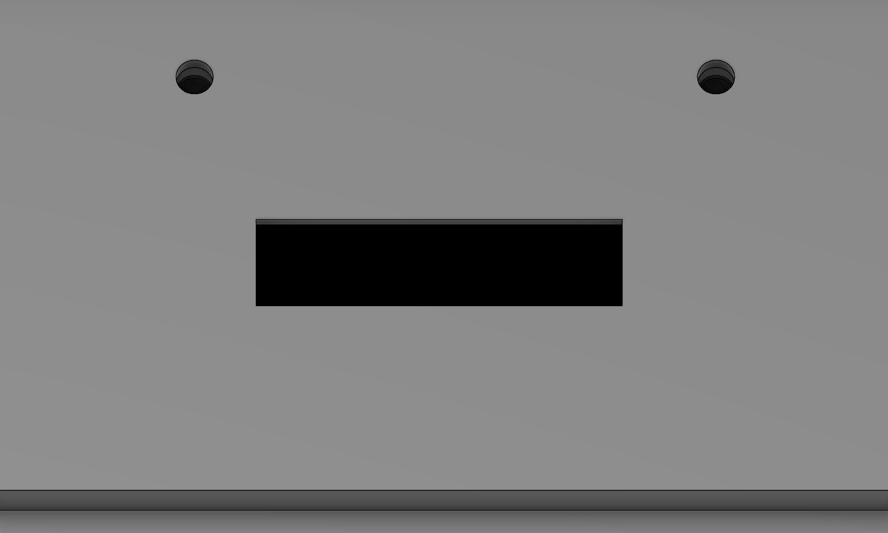
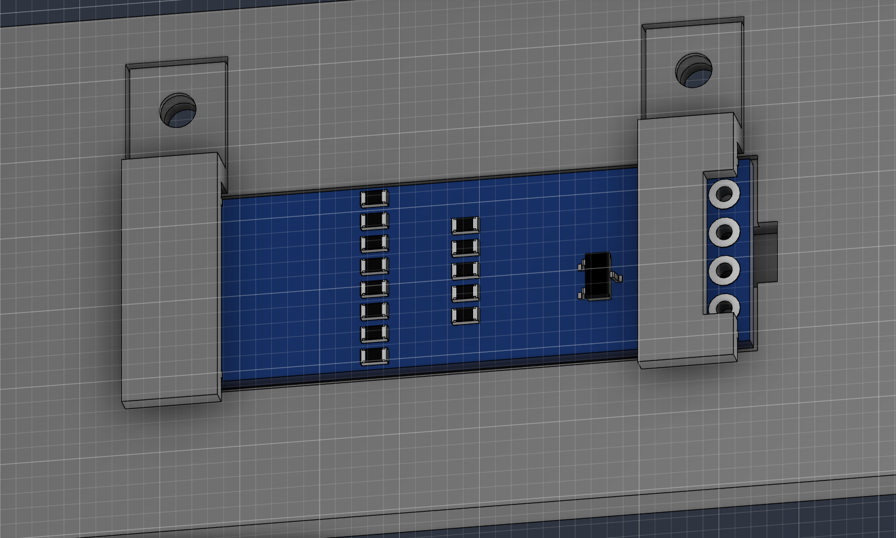

# Tznami-pw1.3
60% keyboard made for the half life project, week1 PCB.

## Why this?
I need a keyboard that will sit nicely on my desk setup, this one thanks to its custom usb slot placement will accomodate my cable management perfectly. 

## PCB
Schematic and PCB Made in kicad.
Schematic            |  PCB
:-------------------------:|:-------------------------:
  |  !

## Case
Made using fusion, using a sandwich mount and an oled mounting mechanism!

Uses stemma QT to connect the oled. connector to MCU and stripped cables soldered to the oled.

## Firmware

Comes with QMK and Vial support. 

